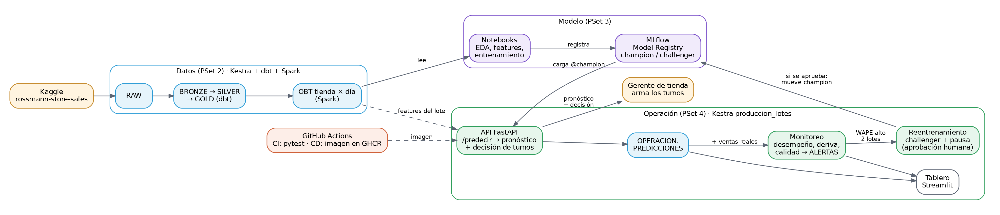

# Proyecto final: pronóstico de ventas diarias para planificar turnos en Rossmann

Pronóstico de las ventas diarias de 1.115 tiendas Rossmann con hasta 42 días de anticipación, para que los gerentes
armen los turnos del personal. Proyecto end to end de los PSets 1 a 4 del curso Fundamentos de Ciencia de Datos.

```
Kaggle → Kestra → Snowflake RAW → dbt (BRONZE → SILVER → GOLD) → Spark (OBT)
       → EDA y modelo (notebooks + MLflow) → Model Registry (champion) → API FastAPI → PREDICCIONES
       → simulación de producción (Kestra) → monitoreo y alertas → reentrenamiento con aprobación humana
```



**Resultado:** en la simulación de 8 lotes (2015-06-20 a 2015-07-31), planificar con el modelo redujo el costo de turnos
mal asignados un 43 % frente a la regla actual del gerente y ganó en los 8 lotes, incluidos los tres con deriva inducida.

## Componentes

| Componente | Qué hace | Dónde |
|---|---|---|
| Kestra | Ingesta, transformación, simulación de producción, monitoreo y reentrenamiento | `kestra/` |
| Snowflake | Capas `RAW`, `BRONZE`, `SILVER`, `GOLD`, `OBT` y tablas de operación (`OPERACION`) | `scripts/snowflake_setup.sql` |
| dbt Core | Tipado, limpieza, star schema, tests y métricas de calidad | `dbt/` |
| Spark | Construcción y validación de la One Big Table | `spark/` |
| MLflow | Experimentos, Model Registry (`rossmann-modelo`, alias `champion` y `challenger`) | `mlflow/` |
| API (FastAPI) | `/salud`, `/modelo`, `/predecir`, `/recargar`, `/metricas`; registra cada predicción | `api/` |
| Monitoreo | Métricas de sistema, modelo y datos; PSI, KS, chi-cuadrado; alertas | `monitoreo/` |
| Tablero (Streamlit) | Desempeño, deriva, decisiones, sistema y alertas por lote | `tablero/` |
| GitHub Actions | CI (pytest) en cada push; CD publica la imagen de la API en GHCR | `.github/workflows/` |

## Estructura

```
proyecto_final/
├── docker-compose.yml        Kestra + Postgres, Spark, MLflow, API y tablero (+ dbt, spark-submit y jobs con --profile jobs)
├── Dockerfile.jobs           imagen de los procesos que lanza Kestra (src/ + monitoreo/)
├── .env.example              variables necesarias (copiar a .env)
├── requirements.txt          entorno de Python para notebooks, scripts y pruebas
├── .github/workflows/        ci.yml y cd.yml
├── kestra/                   flujos de ingesta (PSet 2) y de producción (PSet 4)
├── dbt/, spark/              pipeline ELT del PSet 2
├── src/                      datos.py, pipeline.py, reentrenar.py, lotes.py, simulacion.py
├── notebooks/                01 a 07
├── api/                      Dockerfile, main.py, esquemas.py
├── monitoreo/                deriva.py, alertas.py, monitorear.py
├── tablero/                  app.py de Streamlit
├── tests/                    pruebas de contrato, modelo y comportamiento + fixtures
├── scripts/                  setup de Snowflake, secretos, fixtures y exportación de evidencia
└── docs/                     diagramas, cambios.md, CSV de evidencia, memo, presentación e historial
```

## Requisitos

- Windows con Docker Desktop (Compose v2). Con 12 GB de RAM, asignar unos 7 GB a WSL creando
  `C:\Users\<usuario>\.wslconfig`:
  ```
  [wsl2]
  memory=7GB
  processors=4
  ```
  y ejecutar `wsl --shutdown` antes de abrir Docker Desktop.
- Python 3.12.
- Una cuenta de Snowflake (sirve la de prueba).
- Una cuenta de Kaggle con la API key clásica (*Settings → API → Legacy API Credentials*) y las
  [reglas aceptadas](https://www.kaggle.com/competitions/rossmann-store-sales/rules) de la competencia.
- Para el CD, el repositorio en GitHub (la imagen se publica en `ghcr.io/<usuario>/proyecto_final-api`).

Los comandos son para **PowerShell**, desde la carpeta `proyecto_final`.

## 1. Credenciales y configuración (una vez)

**Llaves de Snowflake.** El usuario de servicio entra con un par de llaves:

```powershell
docker run --rm -v "${PWD}\secrets:/keys" -w /keys alpine sh -c "apk add --no-cache openssl > /dev/null && openssl genrsa 2048 | openssl pkcs8 -topk8 -inform PEM -out rsa_key.p8 -nocrypt && openssl rsa -in rsa_key.p8 -pubout -out rsa_key.pub"
```

**Snowflake.** Copia la llave pública sin las líneas `BEGIN/END`:

```powershell
(Get-Content secrets\rsa_key.pub | Where-Object { $_ -notmatch "-----" }) -join "" | Set-Clipboard
```

Abre `scripts/snowflake_setup.sql` en Snowsight, pega la llave en `RSA_PUBLIC_KEY`, reemplaza `<TU_USUARIO>` y ejecuta
todo. Crea el warehouse `PSET2_WH`, la base `PSET2_ROSSMANN`, el rol `PSET2_ROLE` y el usuario `PSET2_SVC`. El esquema
`OPERACION` (predicciones, monitoreo, alertas) lo crean la API y los scripts la primera vez.

**Variables.** Copia `.env.example` a `.env` y complétalo (cuenta de Snowflake, Kaggle y claves de Kestra). Guárdalo con
fin de línea **LF**. Luego genera los secretos de Kestra (`.env_encoded`):

```powershell
Copy-Item .env.example .env
docker run --rm -v "${PWD}:/work" -w /work bash:5 bash scripts/encode_secrets.sh
```

`.env`, `.env_encoded` y `secrets/` están en `.gitignore`: **no se sube ninguna credencial**.

**Entorno de Python** (notebooks, scripts y pruebas):

```powershell
py -3.12 -m venv .venv
.venv\Scripts\Activate.ps1
pip install -r requirements.txt
```

## 2. Levantar la infraestructura

```powershell
docker volume create pset3_mlflow-data       # solo la primera vez (en el PSet 3 ya existe)
docker compose --profile jobs build           # imágenes de dbt, Spark y jobs que lanza Kestra
docker compose up -d --build                  # Kestra, Spark, MLflow, API y tablero
```

| Servicio | URL |
|---|---|
| Kestra | http://localhost:8080 (usuario y clave de `.env`) |
| MLflow | http://localhost:5000 |
| API | http://localhost:8000/docs |
| Tablero | http://localhost:8501 |
| Spark master / worker | http://localhost:8081 / http://localhost:8082 |

**Importar los flujos en Kestra:** *Flows → Import*, un archivo a la vez y en este orden:

1. `pset2.rossmann.rossmann_ingest_raw.yml`, `pset2.rossmann.rossmann_transform.yml`, `pset2.rossmann.rossmann_backfill.yml`,
   `pset2.rossmann.rossmann_daily_pipeline.yml` (namespace `pset2.rossmann`).
2. `monitoreo.yml`, `reentrenamiento.yml` y `produccion_lotes.yml` (namespace `proyecto.rossmann`).

Si Kestra rechaza un flujo, créalo con *Flows → + Create* y pega el YAML: el editor indica la línea con el error.

## 3. Orden de ejecución completo

### 3.1 Fuente → RAW → BRONZE → SILVER → GOLD → OBT (PSet 2)

En Kestra: **`rossmann_backfill` → Execute** con los valores por defecto (2013-01-01 a 2015-07-31). Descarga los CSV de
Kaggle, los carga en `RAW` y ejecuta `rossmann_transform` (`dbt build` con sus tests y luego Spark, que construye
`OBT.OBT_SALES_DAILY`). Toma unos 20 a 40 minutos. La ingesta se reparte en cuatro flujos (`rossmann_ingest_raw`,
`rossmann_transform`, `rossmann_backfill` y `rossmann_daily_pipeline`, programado a diario a las 05:00).

```sql
select count(*) from PSET2_ROSSMANN.GOLD.FCT_SALES_DAILY;          -- 1.017.209
select * from PSET2_ROSSMANN.OBT.OBT_VALIDATION_LOG order by checked_at desc;
```

### 3.2 EDA y modelo → registro (PSet 3)

Notebooks en orden, con MLflow levantado:

| Notebook | Contenido |
|---|---|
| `01_eda.ipynb` | Exploración de la OBT y hallazgos |
| `02_features.ipynb` | Features con rezago de 42 días y prueba de ausencia de fuga |
| `03_baseline_candidatos.ipynb` | Líneas base, cinco familias de modelos, Chronos-2 y LLM (varias horas) |
| `04_tuning.ipynb` | Búsqueda aleatoria de hiperparámetros (unas 12 horas) |
| `05_seleccion.ipynb` | Evaluación en prueba y registro de `rossmann-modelo`: v1 `champion` (HistGradientBoosting), v2 `challenger` (Random Forest) |
| `05b_reproduccion.ipynb` | Carga `models:/rossmann-modelo@champion` y reproduce la métrica registrada |

Los notebooks 03, 04 y 05 conservan la salida de su ejecución en el PSet 3: volver a ejecutarlos crea corridas y
versiones nuevas en MLflow. Su resultado se verifica con `05b_reproduccion.ipynb`.

### 3.3 API

Se levanta con `docker compose up -d`. Carga `models:/rossmann-modelo@champion`, valida la entrada con Pydantic (422 si
no cumple), devuelve el pronóstico con la decisión de turnos y registra cada predicción en `OPERACION.PREDICCIONES`.

```powershell
curl.exe http://localhost:8000/modelo
curl.exe -X POST http://localhost:8000/predecir -H "Content-Type: application/json" --data "@api/ejemplo_solicitud.json"
```

- **Cambiar de versión o rollback:** mover el alias `champion` en MLflow y llamar a `curl.exe -X POST http://localhost:8000/recargar`.
- **Interruptor de respaldo:** con `MODO_RESPALDO=true` la API responde con la regla del gerente.
  ```powershell
  $env:MODO_RESPALDO = "true";  docker compose up -d api
  $env:MODO_RESPALDO = "false"; docker compose up -d api
  ```

### 3.4 Simulación de producción

Preparar los lotes y la referencia de entrenamiento (una vez, con el entorno de Python activo):

```powershell
python -m src.lotes              # 8 lotes con deriva inducida en 6-8 -> OPERACION.LOTES_SIMULACION
python -m monitoreo.deriva       # muestra de entrenamiento -> OPERACION.REFERENCIA_ENTRENAMIENTO
```

En Kestra, ejecutar **`produccion_lotes`** con `lote = 1, 2, …, 9`, en orden (se encolan y corren uno tras otro). Cada paso:
llegan las ventas reales del lote anterior → monitoreo de su desempeño → reentrenamiento si corresponde → pronóstico del
lote con la API → monitoreo del lote.

### 3.5 Monitoreo

Lo ejecuta `produccion_lotes` llamando al flujo `monitoreo`. Resultados en `OPERACION.MONITOREO` y `OPERACION.ALERTAS`,
en el log de Kestra y en el tablero (http://localhost:8501).

### 3.6 Reentrenamiento

Se dispara por desempeño (WAPE > 0,0945 en 2 lotes seguidos) o por calendario (cada 4 lotes). El flujo `reentrenamiento`
entrena el challenger, lo registra en MLflow, lo compara con el champion y **queda en pausa**: en *Executions*, abrir la
ejecución `PAUSED`, revisar el log de la tarea `comparacion` y presionar **Resume** con la decisión y su motivo.

### 3.7 Análisis y evidencia

```powershell
python scripts\exportar_evidencia.py     # docs/predicciones.csv, monitoreo.csv, alertas.csv, corridas.csv, reentrenamientos.csv
```

| Notebook | Contenido |
|---|---|
| `06_simulacion_produccion.ipynb` | Lotes, deriva inducida, ejecución, reentrenamientos y trazabilidad de una predicción |
| `07_analisis_monitoreo.ipynb` | Monitoreo lote por lote, ética (subgrupos, costo del error, criterios de retirada) y resultado de negocio |

## 4. Pruebas

```powershell
python scripts\exportar_fixtures.py      # solo si cambia el champion: copia del modelo y muestra de prueba
pytest tests -v
```

| Archivo | Qué prueba |
|---|---|
| `test_contrato.py` | 200 con el esquema esperado; 422 por campo faltante, tipo incorrecto y categoría desconocida; respaldo si el modelo no carga |
| `test_modelo.py` | El modelo reproduce el WAPE registrado en MLflow (tolerancia 0,0005) |
| `test_comportamiento.py` | Activar la promoción y aumentar la venta habitual suben el pronóstico |

En GitHub Actions, `ci.yml` corre las pruebas en cada push y pull request, y `cd.yml` publica la imagen de la API en
GHCR con el hash del commit cuando el CI pasa en `main`. El modelo no se despliega solo: lo promueve una persona.

## Documentación

- `docs/PSet4_memo_Pozo_Rivas.pdf`: documento técnico.
- `docs/PSet4_presentacion_Pozo_Rivas.pdf`: presentación ejecutiva.
- `docs/cambios.md`: correcciones a los PSets anteriores y decisiones actualizadas.
- `docs/historial/`: memos de los PSets 1 a 3 y pitch del PSet 1.

## Solución de problemas

- **`failed to connect to the docker API`:** Docker Desktop no está abierto.
- **`Insecure file permissions on rsa_key.p8`:** el conector de Snowflake rechaza la ruta del archivo montado desde
  Windows; la API, el tablero y los jobs leen la llave y la pasan en memoria (`LLAVE_PRIVADA_RUTA` o `LLAVE_PRIVADA_PEM`).
- **La API no carga el modelo** (`/salud` con `modelo_cargado: false`): MLflow aún no arrancó; esperar unos segundos y
  llamar a `/recargar`.
- **`OutOfMemoryError` en Spark:** subir `SPARK_WORKER_MEMORY` en `.env` o la memoria de WSL.
- **`JWT token is invalid` en Snowflake:** la llave pública registrada no corresponde a `secrets/rsa_key.p8`.
- **403 al descargar de Kaggle:** faltan las reglas aceptadas de la competencia.
